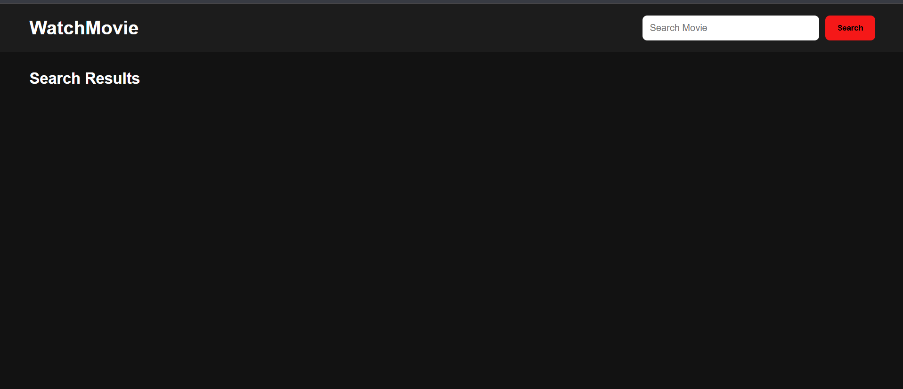
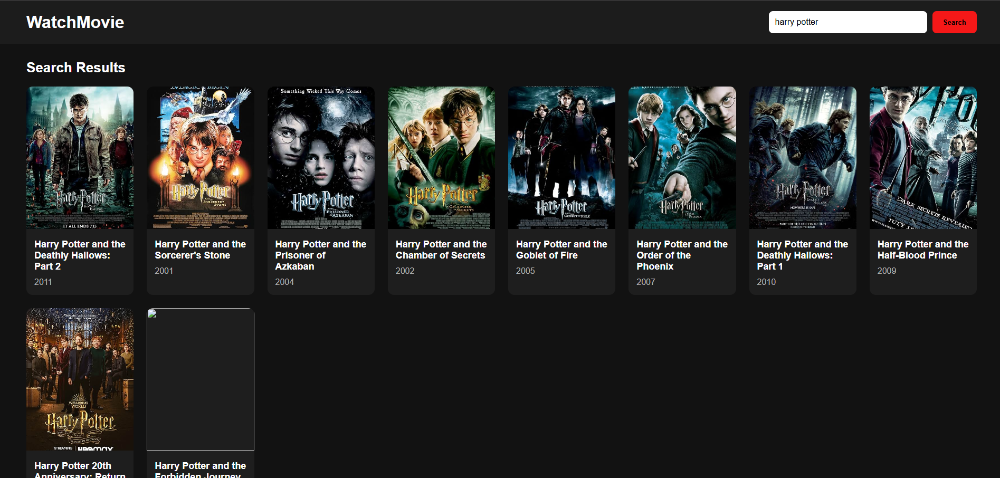
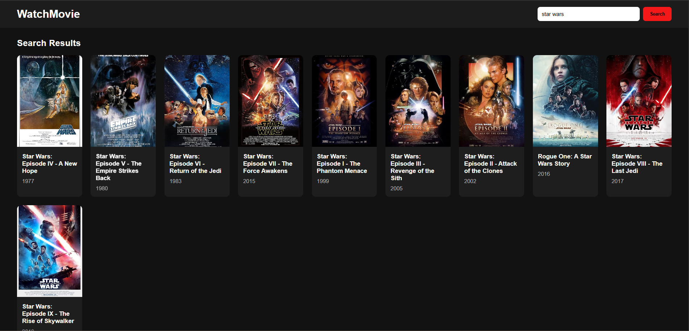

# 🎬 WatchMovie


A simple movie search web app built with **HTML, CSS, and vanilla JavaScript**, made by a cinema fan for cinema fans. Type a movie name, and WatchMovie fetches matching results from the [OMDb API](https://www.omdbapi.com/) and displays them as a responsive grid of movie cards, like a poster wall for your next movie night.

## Features

- Search movies by title
- Search with the **Search** button or by pressing **Enter**
- Responsive card grid showing poster, title, and release year
- Loading message while results are being fetched
- Friendly messages for errors (e.g. "Movie not found!") and network failures
- Dark, Netflix-style theme with hover animation on cards

## Screenshots

### Home Page


### Searching "Harry Potter"


### Searching "Star Wars"


## Tech Stack

| Technology | Purpose |
|------------|---------|
| HTML5 | Page structure |
| CSS3 (Grid, Flexbox) | Layout and styling |
| JavaScript (ES6, `fetch`, async/await) | API calls and DOM rendering |
| OMDb API | Movie data |

## Project Structure

```
movie-app/
├── index.html    # Page markup (rename if your file has a different name)
├── pp9.css       # Styles
├── pp9.js        # Search logic and DOM rendering
├── screenshots/  # Images used in this README
└── README.md
```

## Getting Started

### 1. Get a free OMDb API key

1. Go to [omdbapi.com/apikey.aspx](https://www.omdbapi.com/apikey.aspx)
2. Choose the free plan and register with your email
3. Activate the key from the email you receive

### 2. Add your key

Open `pp9.js` and replace the placeholder:

```js
const apiKey = 'YOUR_API_KEY';
```

with your actual key:

```js
const apiKey = 'abc12345';
```

### 3. Run the app

No build step or dependencies needed. Just open `index.html` in your browser.

For a better workflow, you can use the **Live Server** extension in VS Code (right-click `index.html` → *Open with Live Server*).

## How It Works

1. The user enters a title and clicks **Search** (or presses **Enter**).
2. `searchMovie()` sends a request to the OMDb API:
   ```
   https://www.omdbapi.com/?apikey=YOUR_API_KEY&s=<movie name>
   ```
3. If the response is successful, `displayMovie()` clears the old results and builds a card for each movie using DOM methods.
4. If no movie is found or the request fails, an error message is shown instead.

## Security Note

The API key is stored in client-side JavaScript, so anyone can view it in the browser. This is fine for a learning project with a free key, but **do not commit your real key to a public repository**. Keep a placeholder in the code you push.

## Planned Improvements

- [ ] Movie details modal (plot, rating, cast) when a card is clicked — the modal container and styles are already in place
- [ ] Placeholder image for movies without a poster
- [ ] Pagination / "Load more" for large result sets
- [ ] Favorites list saved in `localStorage`
- [ ] Filter by type (movie / series) and year

## Credits

Movie data provided by the [OMDb API](https://www.omdbapi.com/).

---
